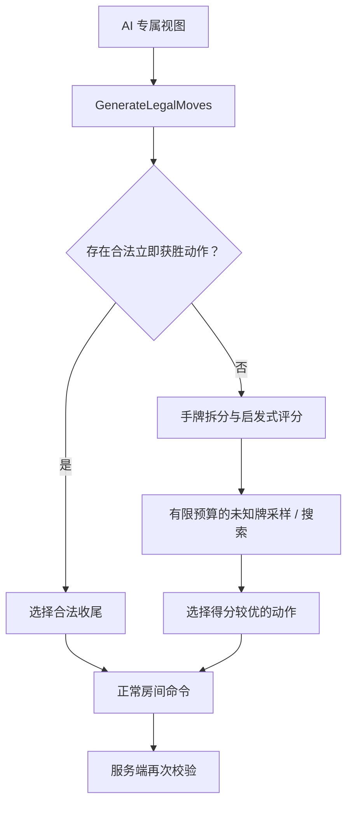

# AI 玩家策略设计（可选开发模块）

> 当前正式规则不依赖 AI。若任务明确包含 AI，应实现一个高质量策略，不提供人为降低水平的分级，不读取隐藏信息。

## 1. 目标与约束

支持机器人通过与真人相同的规则路径出牌，适用于独自练习和房间补位。无需外部模型 API、GPU、强化学习或额外服务。AI 应尽可能聪明，但绝不能靠读取其他玩家手牌、未来牌堆或私密提醒获得优势。

## 2. 输入和输出

AI 输入由服务端为对应机器人构建的玩家视图产生：

- 自己的真实手牌、已公开出牌及公开牌型历史（或等价公开统计）。
- 其他玩家余牌数量、座位、当前行动、公开积分。
- 牌堆数量、玩法、当前轮次、当前待接牌型及不出计数。
- 公开牌组构成（54 张固定牌）。

不允许直接把 `GameState`、其他 `hands`、剩余 deck、随机种子、他人双王提醒或未公开摸牌记录传给 AI。AI 输出一组 `cardIds` 和明确逻辑牌型，或者合法 `pass`。最终经过房间队列及 `ValidatePlay` 校验。

## 3. 决策管线

跟牌时允许把不出作为动作候选；领出时必须选合法出牌。计算超时回退到已验证的确定性启发式动作，不能使用作弊信息或返回非法动作。

## 4. 合法动作与手牌规划

统一使用 `rules.GenerateLegalMoves`，枚举单张、对子、顺子、连对、三至六炸及万能牌解释，再过滤接牌和余牌。AI 不另外维护不同规则。

对每个动作计算剩余手牌质量：

| 因素 | 评估方向 |
| --- | --- |
| 立即获胜 | 绝对优先 |
| 剩余张数 | 减少余牌，但不盲目贪图多出 |
| 最少后续出牌次数 | 优先保留成组牌型 |
| 2 和王 | 避免形成难以合法收尾的组合 |
| 组合弹性 | 保留万能牌匹配不同顺子/连对的能力 |
| 炸弹 | 衡量抢回领出权与消耗高价值资源 |
| 对手余牌 | 对手接近出完时提高阻断优先级 |
| 牌堆数量 | 牌堆越少，越重视确定的收尾路径 |
| 玩法 | 经典全员摸牌；极速领出权附带单人补牌代价 |

最少出牌次数可使用点数计数状态的记忆化搜索；限制搜索节点和时间，较大手牌采用启发式近似。搜索中必须遵守余牌约束，不能把任意切分都算作合法顺序。

## 5. 未知信息推演

可选优化采用符合公开信息的蒙特卡洛采样：

1. 从完整物理牌组减去自己的手牌和已公开打出的牌。
2. 根据公开余牌数量及牌堆数量，将剩余未知物理牌随机分配为假设的其他手牌和假设牌堆。
3. 用同一个规则引擎模拟候选行动后若干轮次，统计胜率、预计积分及风险。
4. 结合启发式分数，选择较优动作。

假设分配不代表真实手牌。不允许读取真实隐藏状态来筛选样本。可以利用公开出牌和不出历史做概率调整，但跟牌允许主动不出，因此不能简单推断某玩家必然没有可接牌。

采样建议逐步引入，先确保启发式策略可靠；对每个候选共享合理的采样条件，以减少比较噪声。

## 6. 两种补牌模式的策略差异

经典模式：领出者和其他玩家均补牌，评估抢回领出权与所有人牌数增长的综合效应。

极速模式：若无人接牌，最后出牌者需要独自补一张；应权衡打出单张后被迫补回一张的成本，以及领出下一轮的收益。牌堆为空后该代价消失，两种模式均不再补牌。

模拟器必须按真实模式执行补牌、余牌校验和第一名获胜，不采用无限补牌或不同的收尾规则。

## 7. 并发与预算

- AI 搜索在房间循环之外执行，输入为不可变视图。
- 带 `gameId`、`revision`、行动者及上下文取消标识；计算结果回到房间队列时再次验证。
- 过期结果丢弃，必要时基于新快照重新计算，不执行旧动作。
- 初始可使用约 50～200 ms 的软预算，并设置硬上限（例如 500 ms），具体根据实际硬件压测确定。
- 限制并发 AI 工作线程、最大节点、缓存容量；取消房间时停止相关任务。
- 测试注入固定随机种子，以便复现。生产策略随机性与实际洗牌源隔离。

## 8. 策略评估与公平性

必测：
- 单 2/对 2、双王、三至六张炸弹及万能牌多义解释处理正确。
- 所有动作符合正式规则；领出永远给出合法动作。
- 不合法的余牌集合从未产生。
- 相同可见输入、相同策略随机种子下，仅改变其他玩家真实手牌或真实牌堆顺序，AI 输出保持一致。
- 超时回退合法，取消、旧 revision 与并发不会污染状态。

策略质量通过与随机合法动作基线和早期启发式基线进行固定种子对照赛评估；同时记录座位、人数、模式、胜率、平均零和积分、思考时延和超时率。不要承诺“必胜”或虚构胜率。优化目标为更稳定的公平策略，不设置难度等级。

## 9. 接入与范围

若明确启用 AI，房间允许房主在等待阶段增删机器人，真人和机器人均占正式席位；机器人同样发牌、补牌、结算。首页可提供快速开始，默认人数与模式由产品配置决定。不提供未实现的按钮。训练模型、神经网络策略、观战 AI 和跨局学习均为可选后续研究。
