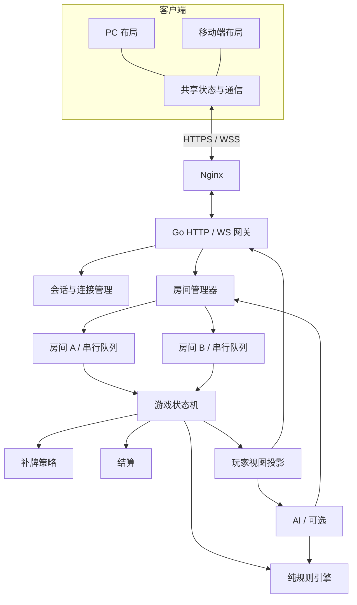
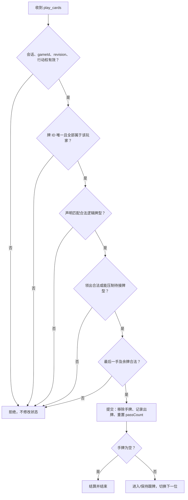
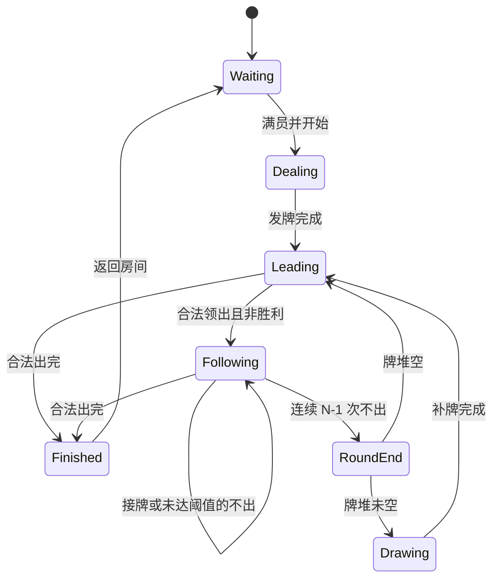
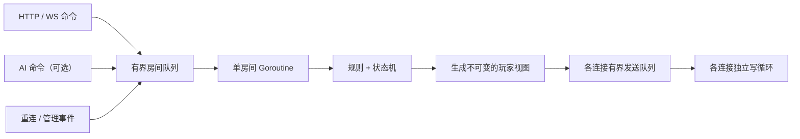

# 技术架构设计

> 游戏规则版本 V1.3。以 [RULES.md](RULES.md) 为准；工程默认值见 [DECISIONS.md](DECISIONS.md)。

## 1. 架构目标

用最少的服务和依赖完成稳定的多人实时游戏。规则可独立测试，房间并发隔离，前端不掌握隐藏信息，网络中断不会使牌局状态错乱；后续可扩展 AI 和补牌策略，不为尚未确认的胜负模式过度设计。

## 2. 技术栈

| 层 | 选型 |
| --- | --- |
| 前端 | Vue 3、TypeScript、Vite、Pinia、CSS/SVG |
| 后端 | Go 单体应用 |
| 通信 | HTTP REST + WebSocket JSON |
| 数据 | 进程内存；不强制依赖持久化 |
| 测试 | Go testing、race detector、TypeScript 类型检查、前端测试及浏览器 E2E |
| 部署 | Nginx + systemd；可使用 Go Embed 打包前端 |
| 可选 AI | Go 规则驱动、有限搜索，不依赖训练或外部模型 |

依赖版本由实际实现时选择相互兼容的稳定版并锁定；不以具体版本号作为规则前置条件。不引入数据库、Redis、Docker、微服务、3D 游戏引擎或外部 AI API 的强制依赖。

## 3. 总体架构



一个 Go 进程承载多个房间。各房间持有自己的状态，规则函数不持有全局可变状态。图中共享模块表示共享代码，并非共享一局游戏的可变对象。

## 4. 模块边界

| 包 | 职责 | 不承担 |
| --- | --- | --- |
| `card` | 物理牌定义、发牌、洗牌、牌堆 | 牌型比较 |
| `rules` | 牌型枚举、万能牌解析、比较、余牌校验、合法动作枚举 | 网络、积分、房间操作 |
| `game` | 游戏状态、轮次、原子出牌、补牌、结算 | 网络 I/O |
| `room` | 房间及席位、房主、串行命令循环、生命周期 | 绕过游戏引擎改牌 |
| `session` | 会话凭证、连接替换、重连 | 规则判断 |
| `protocol` | API DTO、消息编码、错误码、校验 | 将内部状态直接序列化 |
| `ai` | 可选策略、有限搜索 | 读取其他手牌、直接修改状态 |
| `webassets` | 生产静态资源嵌入 | 游戏逻辑 |

依赖方向：`rules → card`；`game → rules/card`；`room → game`；`session/protocol` 连接房间命令和 DTO；`ai` 只依赖公开/私人视图、规则引擎及抽象动作接口。避免 `game → room`、`rules → protocol` 等循环依赖。

## 5. 物理牌和标准牌型

### 5.1 物理牌

使用 `CardID` 区分每张牌，推荐固定编号：

- 0～51：按 3、4、…、A、2 的点数组分组，每组 4 个花色；花色顺序固定，例如梅花、方块、红桃、黑桃。
- 52：小王；53：大王。物理 ID 不相同，规则大小等价。
- `Rank` 使用整数 3～15（J=11、Q=12、K=13、A=14、2=15）；王不分配普通点数。

生产洗牌使用 Go 安全随机源生成无偏随机索引，执行 Fisher–Yates；测试可注入确定性随机源。客户端不能决定洗牌种子。不得公开未使用的随机种子、牌堆顺序和其他玩家手牌。

守恒条件：每张 ID 在任何已提交状态中只属于牌堆、某位玩家手牌或已打出的牌集合之一。当前待接牌、展示牌、历史事件只能引用已打出集合，不能重复计入库存。

### 5.2 标准逻辑牌型

示意接口（实现可调整 Go 类型名，但语义保持）：

```go
type CardID uint8
type Rank uint8
type PatternKind string

type Wildcard struct {
    CardID CardID
    Rank   Rank
}

type Pattern struct {
    Kind      PatternKind
    Rank      Rank     // 单/对/炸点数；顺子/连对起点
    Length    int      // 物理牌总张数，而非对子组数
    CardIDs   []CardID
    Wildcards []Wildcard
}
```

`Kind` 统一为 `single`, `pair`, `straight`, `pair_run`, `bomb`。炸弹由 `Length=3..6` 区分；`pair_run` 的组数为 `Length/2`。王不能单独构成牌型。普通牌物理点数与逻辑点数始终一致。

比较键只使用 `Kind/Rank/Length`。王的数量、大小王的身份、花色均不影响大小。对于等价的王位置互换，按王物理 ID 和缺失点数的固定顺序规范化映射，避免重复显示同一逻辑解释。

### 5.3 规则接口

```go
func ResolvePatterns(selected []CardID) []Pattern
func CanBeat(candidate Pattern, previous Pattern) bool
func ValidateRemaining(remaining []CardID) error
func ValidatePlay(ctx PlayContext, req PlayRequest) (Pattern, error)
func GenerateLegalMoves(ctx PlayContext) []Move
func CanFinish(ctx PlayContext) bool
```

纯规则函数接受显式输入，不读房间全局变量；`PlayContext` 至少包括自己的手牌、领出/跟牌状态、当前待接牌型。`GenerateLegalMoves` 生成所有不同的合法逻辑动作（物理花色等价的动作可确定性去重，但必须保留可执行 CardIDs）；并按统一规则过滤余牌限制。`CanFinish` 搜索合法全手出牌。

### 5.4 牌型枚举策略

建立 13 个点数计数和 0～2 张王计数。按类型枚举候选目标，再匹配物理牌：

- 单张：所有普通点数；对子：同点数自然牌或一张自然牌＋王。
- 顺子：长度 3～12、起点与终点均在 3～A；每点需求 1。
- 连对：偶数长度 4～24、起点与终点均在 3～A；每点需求 2。
- 炸弹：每个普通点数的 3～6 张同点数目标；至少一张自然牌。
- 对每个目标枚举符合需求的自然牌使用数与所需王数（包括可用王替代本来持有的自然牌，以保留其他合法策略），按确定性规则选择等价花色的物理 ID。
- 对玩家指定的选牌进行 `ResolvePatterns` 时，必须恰好消耗全部选中牌，不能忽略多余牌、重复 ID 或非法改写自然牌。
- 将候选按待接牌型、最后一手限制和剩余手牌过滤。跟牌可额外提供 `pass`，领出不提供。

不采用全手牌 `2^n` 子集暴力枚举。小手牌可用穷举作为测试预言机，验证优化枚举没有遗漏。

### 5.5 出牌事务



最后一手限制单独检查：单 2、对 2（含赖子）不能收尾；单王与双王已在牌型识别阶段拒绝。余牌限制精确禁止 1～2 张且全部为 2/Joker 的非空集合。

## 6. 游戏状态机



`Dealing`、`RoundEnd`、`Drawing` 可以是房间命令中的同步内部阶段。不得让客户端动画驱动这些状态转换，也不允许在它们中间接收下一手出牌。对外可统一提交稳定状态快照，并附带有序展示事件。

### 6.1 核心状态

| 字段 | 语义 |
| --- | --- |
| `roomId` / `gameId` | 房间与当前对局唯一标识 |
| `mode` | `classic` / `speed` |
| `phase` | `waiting` / `leading` / `following` / `finished`（对外稳定阶段） |
| `players` | 固定座位顺序、玩家身份、在线状态 |
| `hands` | 按玩家隔离的服务端真实手牌 |
| `deck` | 剩余物理牌序列 |
| `played` | 已打出物理牌及必要记录 |
| `currentPlayerId` | 当前行动者；结束时为空 |
| `lastPlayPlayerId` | 最后成功出牌者；新轮领出可保留作展示 |
| `lastPattern` | 当前需要接的逻辑牌型；领出时为空 |
| `passCount` | 从最后一次成功出牌起连续不出次数 |
| `roundNumber` | 初始 1，每次新轮＋1 |
| `revision` | 房间状态单调递增版本号 |
| `winnerId` / `settlement` | 仅结束时存在 |
| `doubleJokerNotified` | 按玩家、按对局保存私密提醒状态 |

### 6.2 行动处理伪代码

```text
play(actor, selection, declaration):
  checkSessionAndTurn()
  pattern = validatePlayWithoutMutation(...)
  removeSelectedCards()
  appendPublicPlay(pattern)
  lastPlayPlayer = actor
  lastPattern = pattern
  passCount = 0
  if hand(actor) is empty:
      settleOnce(actor)
      phase = finished
      currentPlayer = none
      commitAndPublish()
      return
  phase = following
  currentPlayer = nextSeat(actor)
  commitAndPublish()

pass(actor):
  require phase == following and actor == currentPlayer
  passCount += 1
  if passCount < N - 1:
      currentPlayer = nextSeat(actor)
  else:
      finishRound()
  commitAndPublish()

finishRound():
  leader = lastPlayPlayer
  for target in drawPolicy.targets(leader, seatOrder):
      if deck is empty: break
      drawOne(target)
      checkDoubleJokerPrivateNotice(target)
  roundNumber += 1
  currentPlayer = leader
  lastPattern = none
  passCount = 0
  phase = leading
```

`settleOnce` 以 `gameId` 保证仅计算一次积分。发生异常时不返回部分提交；应记录可诊断错误并保护进程，而不是编造流局、补牌或自动转移领出权。

### 6.3 补牌策略

```go
type DrawPolicy interface {
    DrawTargets(leader PlayerID, seatOrder []PlayerID) []PlayerID
}
```

经典：从 leader 开始，按逆时针返回全员；极速：仅返回 leader。统一 `drawOne`，有牌才摸。牌堆耗尽后不再发牌。当前两种模式共享胜利判定、状态机和规则，不分叉实现。

### 6.4 不变量与终止性

- 发牌后的 5/6 张手牌一定不是禁止的 1～2 张特殊牌集合。
- 合法出牌保证所有非空余牌都不是禁止集合；摸牌只增加手牌，不会把合法非空手牌变成禁止集合。
- 任意合法非空手牌都有领出动作：全为特殊牌且至少三张可组成 2 炸；有至少两张 3～A 可领出一张普通牌；恰好一张 3～A 时，可视特殊牌数量与组成，先打单 2、对 2、2 炸，或与王组合出牌，且不会遗留禁止集合。
- 每次成功出牌至少消耗一张物理牌；牌不会回收，总共最多 54 张被打出。在玩家持续响应的前提下，每次连续不出至多 N−1 次便重新领出，因此不会出现规则造成的无限轮次。
- 真人不响应仍可能暂停游戏；这是连接与操作策略问题，不是新增胜负规则的理由。

## 7. 房间并发



- 房间管理器用互斥保护房间索引，不持锁执行房间游戏逻辑。
- 每房间只有一个状态拥有者；所有可能修改房间状态的命令通过其队列。
- 网络读写、慢连接和 AI 搜索不阻塞房间执行循环。
- 有界队列满时按类型拒绝新命令或断开慢消费者，由重连快照恢复；不能悄悄丢弃已接受的出牌。
- 重连替换旧连接时使用连接代数/ID，旧连接延迟关闭不得把新连接标记为离线。
- 房间关闭时取消上下文、清理计时器/AI任务、关闭连接并释放索引。销毁与入队需防止 send-on-closed-channel。
- 游戏中座位固定；未开始/结算阶段允许房主进行房间管理。

## 8. 同步与信息隔离

服务端内部 `GameState` 不直接序列化。对每位玩家生成 `PlayerView`：公共席位、公开牌型、各自余牌数、牌堆数量、当前行动与自己的物理手牌；其他手牌、牌堆顺序、他人私密提醒不可见。

任何合法状态变更增加房间 revision，推送最新快照。客户端以快照为准，不靠历史增量消息重放才能恢复。动画事件不是权威状态；落后、丢失或重连时可跳过动画。

HTTP、WebSocket 与会话细节见 [PROTOCOL.md](PROTOCOL.md)。

## 9. 断线与生命周期

会话 token 与席位关联，重连时验证后替换旧连接，发送最新私人快照。服务端不因为掉线而自动移交行动权或判负。全员离线超时可回收资源，不计分；正常在线牌局不受空房回收影响。关闭房间或服务重启造成的取消不同于正常游戏结算。

进程重启默认丢失内存牌局与房间累计积分。生产发布需停止新开局、尽可能等待已有局完成，并明确不可跨重启恢复的限制；见 [DEPLOYMENT.md](DEPLOYMENT.md)。

## 10. 推荐项目目录

```text
gandengyan/
├── AGENTS.md
├── README.md
├── docs/
├── server/
│   ├── cmd/server/main.go
│   ├── internal/
│   │   ├── card/
│   │   ├── rules/
│   │   ├── game/
│   │   ├── room/
│   │   ├── session/
│   │   ├── protocol/
│   │   ├── ai/                 # 可选
│   │   └── webassets/          # 生产前端资源
│   └── go.mod
├── web/
│   ├── src/
│   │   ├── assets/
│   │   ├── components/
│   │   ├── layouts/desktop/
│   │   ├── layouts/mobile/
│   │   ├── views/
│   │   ├── stores/
│   │   ├── composables/
│   │   ├── network/
│   │   └── types/
│   └── package.json
├── tests/
│   ├── integration/
│   ├── simulation/
│   └── e2e/
├── deploy/
│   ├── nginx.conf
│   └── gandengyan.service
├── Makefile
└── .gitignore
```

`go:embed` 只能访问所属包/模块允许的资源路径；构建时将 Vite dist 复制到 `server/internal/webassets/dist/` 后嵌入，不使用越级 `../web/dist` 指令。目录中所有代码和脚本均为目标结构，本设计包并未实现这些文件。

## 11. 架构质量指标

- 无规则或积分逻辑的前后端双重权威。
- 跨房间无状态串扰；同房间无竞态修改。
- 错误操作原子拒绝；重复请求不重复执行。
- 公共消息、日志和 AI 输入均不泄露隐藏信息。
- 核心游戏函数可脱离网络单测。
- 支持 2～5 人 × 2 种模式的模拟及集成验收。
- 部署步骤、真实测试结果和回滚限制可追溯。
