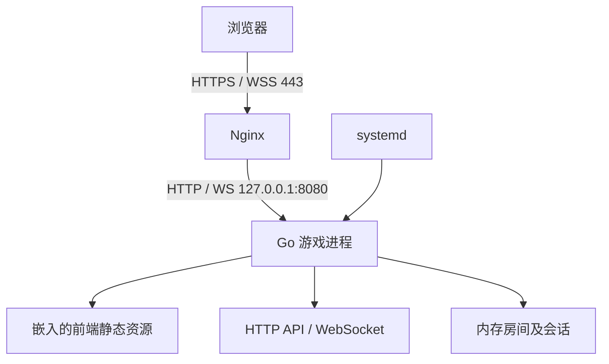

# 构建、部署与运维方案

> 目标环境：Linux 单服务器、Go 单体服务、Nginx 反向代理、systemd。以下配置为开发和部署模板，不表示已经存在或已上线的服务。

## 1. 部署目标



无需数据库、Redis、Docker 和生产 Node.js 进程。初期可在 1 核 1 GB 或 2 核 2 GB 服务器开展验证，实际承载能力通过压测决定；若加入 AI，需要额外评估 CPU 峰值与并发预算。

## 2. 构建约定

- 前端使用锁定依赖的 Vite 生产构建。
- 将 `web/dist/` 复制到 `server/internal/webassets/dist/`，由 Go Embed 打包。
- Go 使用项目锁定的模块依赖进行编译；CI 先执行测试再构建。
- 构建产物记录 Git commit、构建时间、协议版本与规则版本。不得仅凭文件名判断线上版本。
- 构建和部署脚本应可重复运行，不覆盖未知的用户配置。

目标命令（实现后应提供）：

```bash
make test
make build
```

建议输出 `dist/gandengyan`，同时生成校验和及版本元数据。前端资源通过同源 `/api/`、`/ws` 访问后端；开发环境 Vite 可配置代理，不将生产域名写死在源码中。

## 3. 服务器目录与权限

```text
/opt/gandengyan/
  releases/
    <build-id>/
      gandengyan
      SHA256SUMS
  current -> releases/<build-id>
  config.json
  data/
```

应用使用独立的非 root 账号 `gandengyan`，只允许写必要目录（例如 data）。服务监听 `127.0.0.1:8080`，不直接开放后端端口。仅在配置文件或受控环境变量中保存必要配置，不提交真实 token、私钥或证书。

建议配置结构（最终字段以实现为准）：

```json
{
  "listen": "127.0.0.1:8080",
  "allowedOrigins": ["https://example.com"],
  "maxMessageBytes": 32768,
  "heartbeatSeconds": 25,
  "idleOfflineRoomMinutes": 30,
  "logLevel": "info"
}
```

房间、连接、队列、会话和 AI 的上限由负载测试设定。禁止把没有验证的容量写成承诺。

## 4. Nginx 反向代理模板

在 Nginx 的 `http` 上下文配置：

```nginx
map $http_upgrade $connection_upgrade {
    default upgrade;
    '' close;
}
```

站点配置示例（替换域名和真实证书路径，TLS 证书由部署方配置）：

```nginx
server {
    listen 80;
    server_name example.com;
    return 301 https://example.com$request_uri;
}

server {
    listen 443 ssl;
    server_name example.com;
    ssl_certificate /path/to/fullchain.pem;
    ssl_certificate_key /path/to/privkey.pem;

    client_max_body_size 32k;

    location /ws {
        proxy_pass http://127.0.0.1:8080;
        proxy_http_version 1.1;
        proxy_set_header Upgrade $http_upgrade;
        proxy_set_header Connection $connection_upgrade;
        proxy_set_header Host $host;
        proxy_set_header X-Forwarded-Proto $scheme;
        proxy_set_header X-Forwarded-For $proxy_add_x_forwarded_for;
        proxy_read_timeout 90s;
        proxy_send_timeout 90s;
        proxy_buffering off;
    }

    location / {
        proxy_pass http://127.0.0.1:8080;
        proxy_set_header Host $host;
        proxy_set_header X-Forwarded-Proto $scheme;
        proxy_set_header X-Forwarded-For $proxy_add_x_forwarded_for;
    }
}
```

注意：`client_max_body_size` 不限制 WebSocket 帧，Go 服务仍必须设置 WebSocket 消息读取上限。只信任来自本机受控反向代理的转发头。静态资源可按内容哈希设置长期缓存；首页、API 与游戏状态不使用错误的长缓存策略。

检查配置：

```bash
sudo nginx -t
sudo systemctl reload nginx
```

## 5. systemd 服务模板

`/etc/systemd/system/gandengyan.service`：

```ini
[Unit]
Description=Gandengyan Game Server
After=network.target

[Service]
Type=simple
User=gandengyan
Group=gandengyan
WorkingDirectory=/opt/gandengyan
ExecStart=/opt/gandengyan/current/gandengyan -config /opt/gandengyan/config.json
Restart=on-failure
RestartSec=3
KillSignal=SIGTERM
TimeoutStopSec=30
NoNewPrivileges=true
PrivateTmp=true
ProtectSystem=strict
ProtectHome=true
ReadWritePaths=/opt/gandengyan/data

[Install]
WantedBy=multi-user.target
```

启动前创建账号、目录和配置，确认 `-config` 参数与实际程序一致，确保服务账号具有读取/执行权限及指定目录写权限。

```bash
sudo systemctl daemon-reload
sudo systemctl enable --now gandengyan
sudo systemctl status gandengyan
journalctl -u gandengyan -n 100 --no-pager
curl -fsS http://127.0.0.1:8080/healthz
```

## 6. 公网安全检查

- HTTPS 与 WSS 可用，HTTP 重定向至 HTTPS，证书有效。
- 后端端口仅本机访问；主机防火墙只开放必要端口。
- 认证、房间号撞库防护、创建/加入限速、连接数限制与 Origin 校验生效。
- 所有牌局请求重新验证身份、行动权、牌 ID、牌型、revision；不能靠前端隐藏。
- 日志不包含 session token、其他玩家手牌、牌堆顺序和双王私密提醒。
- 日志轮转或 journald 保留策略避免耗尽磁盘。
- 健康检查不公开配置、连接凭证、房间内部状态或调试接口。

## 7. 发布与回滚

内存房间默认不能跨进程重启恢复，升级不是天然无损。上线前应实现或明确操作级别的排空方案：

1. 备份现有可执行文件、配置和必要的持久化资料；核对当前版本及校验和。
2. 上传新构建到独立 releases 目录，检查二进制、权限、依赖和启动参数。
3. 使用维护/排空机制禁止新开局，允许已有局完成；等待期限与取消策略由运营配置明确。
4. 如仍有未完成牌局，告知维护影响；不得把中断的对局伪装成正常结算。
5. 切换 `current` 指向新版本，重启服务，检查 healthz、版本和 HTTPS/WSS。
6. 用测试房间验证创建、加入、出牌、补牌、结算、重连；测试数据不得污染正常累计积分。
7. 出现严重问题时切回上一个经校验的版本并重启。程序回滚不能恢复已经丢失的内存牌局。

若第一版尚未提供主动排空接口，应安排确认无进行中牌局的维护窗口，明确记录限制。未授权不得执行生产发布。

## 8. 监控与运维

建议记录版本、启动/关闭、活跃房间数、在线连接数、正常结束局数、异常命令计数、房间队列压力、请求延迟及资源使用。日志使用结构化字段（roomId、gameId、revision、错误码）并脱敏；不输出隐藏牌面。

优先依靠 systemd/journald、主机监控和简单健康检查，达到容量瓶颈后再增加独立监控设施。房间状态默认驻留内存，空房间和已失效会话定期清理。全员离线房间回收属于资源管理，不属于胜负结算。

## 9. 部署验收清单

- [ ] 真实构建及测试报告已生成。
- [ ] 版本与校验和一致，生产配置不含示例域名/证书路径。
- [ ] HTTPS/WSS 正常，Nginx 超时与心跳匹配。
- [ ] 服务自动启动及异常重启可用。
- [ ] 创建/加入、2～5 人、两种模式和重连已做冒烟验证。
- [ ] 无其他玩家隐藏信息泄露。
- [ ] 资源回收、日志和限速可用。
- [ ] 升级影响、数据保存边界、回滚方式已明确。
- [ ] 未执行的检查与真机验证如实记录。
